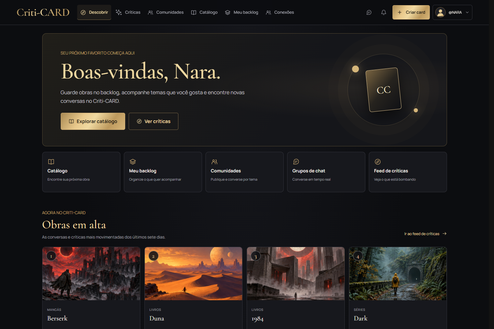
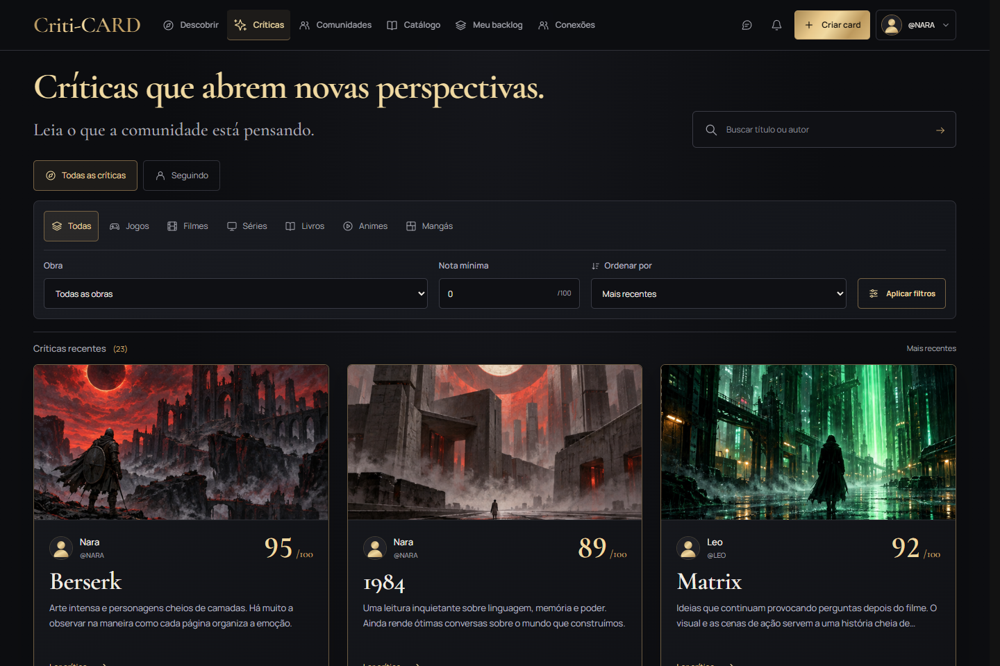
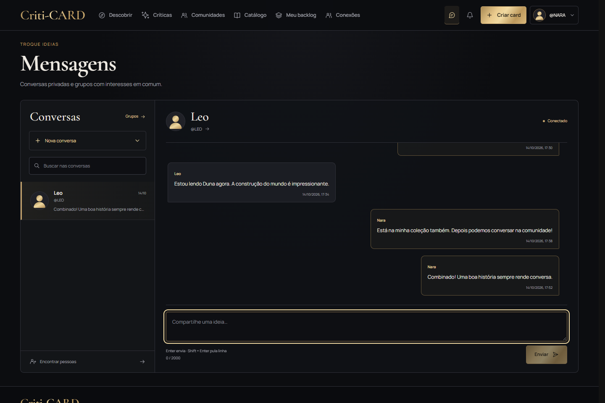
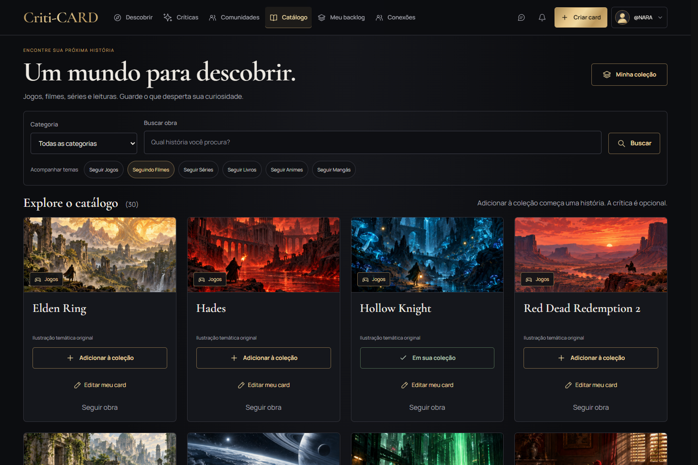
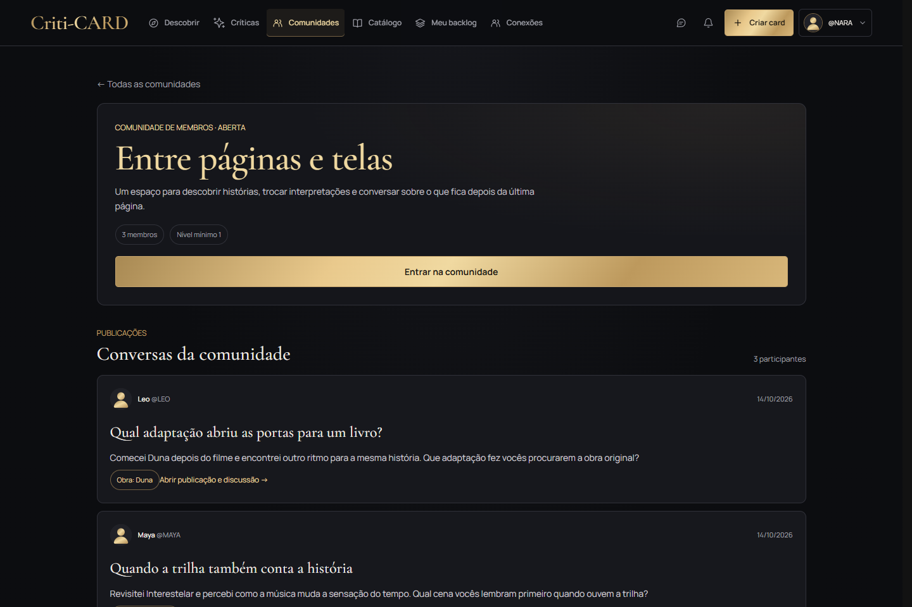
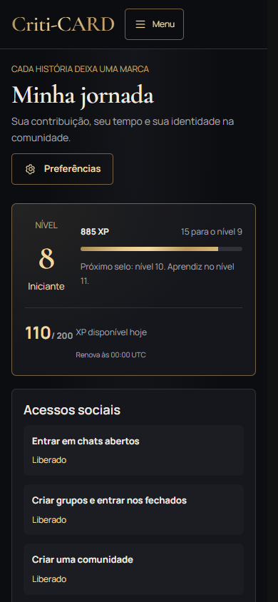

# Criti-CARD

[](https://github.com/LDev-BR/Criti-CARD/actions/workflows/ci.yml)
[](LICENSE)

Rede social para compartilhar críticas de jogos, filmes, séries, animes, livros e mangás. Cada pessoa pode organizar seu backlog, publicar uma avaliação por obra, acompanhar autores e temas, participar de comunidades e conversar em tempo real.

O projeto começou como trabalho de estudos no Senac e evoluiu para uma aplicação Flask organizada por funcionalidades. Este repositório apresenta o código, as decisões técnicas, os testes e a documentação de operação. A aplicação pode ser executada localmente; não há uma demonstração hospedada anunciada aqui.

## A aplicação

As capturas abaixo mostram a aplicação real com dados fictícios preparados exclusivamente para o portfólio. [Veja todas as telas e como reproduzir as capturas](docs/screenshots/README.md).

### Descoberta



### Críticas e leitura



### Conversas



<details>
<summary>Catálogo, comunidades e jornada no celular</summary>







</details>

## Funcionalidades

| Área | O que oferece |
| --- | --- |
| Descoberta | Obras em alta, comunidades recomendadas e novidades de autores, obras e categorias seguidas |
| Críticas | Uma crítica publicada por pessoa/obra, notas de 0 a 100, filtros, ordenação, leitura completa e histórico privado de duplicatas antigas |
| Catálogo e backlog | Seis categorias, 30 obras iniciais, capas compartilhadas do catálogo, status, progresso e visibilidade por item |
| Relações sociais | Seguir pessoas, obras e temas; amizades por convite; curtidas, comentários, bloqueios e denúncias |
| Comunidades | Publicações, comentários e reações; acesso aberto ou fechado, convites, pedidos e moderação própria |
| Mensagens | Conversas diretas e chats em grupo, histórico paginado, recibos de leitura, reconexão e envio idempotente |
| Jornada | XP, níveis, conquistas e adornos cosméticos, com regras de participação verificadas no servidor |
| Conta | Cadastro, perfil, preferências, recuperação/verificação de email quando configuradas e revogação de sessões |
| Privacidade | Backlog inicialmente privado, exportação de dados próprios, pedidos particulares e exclusão de conta |
| Administração | Catálogo, moderação, usuários, suporte, pedidos de privacidade e gestão da jornada |

Os fluxos essenciais renderizam no servidor e oferecem alternativas sem JavaScript. A interface considera teclado, foco, responsividade, contraste e redução de movimento. A cobertura e os limites estão descritos em [testes](docs/testing.md) e [funcionalidades](docs/features.md).

## Stack e decisões técnicas

- **Python 3.11+ e Flask:** fábrica de aplicação e blueprints por funcionalidade; Python 3.13 é a versão de referência.
- **SQLAlchemy e Alembic:** consultas e transações portáveis, esquema versionado e migrações explícitas.
- **SQLite no desenvolvimento e PostgreSQL na publicação:** testes descartáveis cobrem os dois bancos.
- **Jinja, CSS e JavaScript próprios:** HTML renderizado no servidor, componentes de template reutilizáveis e módulos JavaScript nativos.
- **Flask-SocketIO:** mensagens em tempo real com autorização independente em cada evento.
- **Pillow:** validação e regravação de imagens; arquivos locais ou armazenamento S3 configurado explicitamente.
- **pytest, Node, Playwright e axe-core:** regras de negócio, integração HTTP, JavaScript, navegador e acessibilidade.

As regras ficam nos serviços da funcionalidade; rotas cuidam do HTTP e templates da apresentação. Bloqueios, propriedade dos dados, CSRF e permissões são verificados no servidor. [A arquitetura](docs/architecture.md) explica essas fronteiras e o ciclo dos dados.

## Executar localmente

Requisitos: Git e Python 3.11 ou superior. Node.js é necessário apenas para os testes JavaScript e as ferramentas de acessibilidade, não para servir a aplicação.

### Windows / PowerShell

```powershell
git clone https://github.com/LDev-BR/Criti-CARD.git
Set-Location Criti-CARD
py -m venv .venv
.\.venv\Scripts\python.exe -m pip install -r requirements.txt
powershell -NoProfile -ExecutionPolicy Bypass -File .\run.ps1
```

`run.ps1` aplica as migrações ao banco configurado antes de iniciar o servidor. Em uma instalação nova, o banco SQLite e as pastas locais são criados automaticamente. Para um banco existente, faça backup antes de executar migrações.

### Linux / macOS

```bash
git clone https://github.com/LDev-BR/Criti-CARD.git
cd Criti-CARD
python3 -m venv .venv
source .venv/bin/activate
python -m pip install -r requirements.txt
python -m flask --app criticard db-upgrade
python app.py
```

Abra [a descoberta](http://127.0.0.1:5000/feed), [as críticas](http://127.0.0.1:5000/criticas) ou [o login](http://127.0.0.1:5000/). Crie uma conta pela interface para publicar e organizar o backlog. Não há senha de demonstração embutida nem conta administrativa padrão.

O projeto roda no desenvolvimento sem `.env`. Para personalizar, copie `.env.example` para `.env`; a configuração local fica fora do Git. Uma chave de sessão é mantida em `instance/secret_key`. A administração é criada somente quando suas credenciais são configuradas explicitamente. [O guia de instalação](docs/getting-started.md) cobre esse fluxo e problemas comuns.

## Rotas principais

| Rota | Finalidade |
| --- | --- |
| `/feed` | Página de descoberta |
| `/criticas` | Feed de críticas com busca, filtros e paginação |
| `/catalogo` | Catálogo e controles para seguir obras/temas |
| `/backlog` | Coleção pessoal |
| `/perfil/<username>` e `/colecao/<username>` | Perfil e coleção pública |
| `/comunidades/` | Comunidades temáticas e participação |
| `/mensagens` e `/mensagens/grupos` | Conversas privadas e descoberta de grupos |
| `/jornada` | Progresso, conquistas e personalização |
| `/configuracoes` | Preferências, conta e bloqueios |
| `/cadastro_cards` | Publicação de crítica vinculada ao catálogo |
| `/privacidade` e `/privacidade/pedidos` | Política e pedidos particulares |
| `/admin` | Administração autorizada |

Exemplo de filtro compartilhável: `/criticas?categoria=mangas&nota_min=90&ordem=highest`. O filtro `/criticas?feed=following` acompanha autores, obras e categorias seguidas. As capas dos cards vêm do catálogo; a publicação de uma crítica não exige upload de capa.

## Testes e integração contínua

Com o ambiente virtual ativo:

```bash
python -m pip install -r requirements-dev.txt
python -m pytest -q
npm ci --ignore-scripts
npm test
```

No PowerShell, sem ativar o ambiente, use `.\.venv\Scripts\python.exe` em lugar de `python` e `npm.cmd` em lugar de `npm`.

Os testes usam bancos e diretórios descartáveis. PostgreSQL e navegador exigem ativação explícita; não aponte as variáveis de teste para o banco da aplicação. A instalação de Chromium, as variáveis de integração e os comandos completos estão em [docs/testing.md](docs/testing.md).

[O workflow de CI](.github/workflows/ci.yml) configura Python em Linux e Windows, testes JavaScript, PostgreSQL 18 e navegador Chromium. O badge reflete as execuções do GitHub; a primeira execução ocorre após o envio do commit. Nenhum job publica a aplicação ou usa credenciais de produção.

## Documentação

O [índice da documentação](docs/README.md) organiza os guias para quem deseja usar, contribuir, revisar ou operar o projeto.

| Guia | Conteúdo |
| --- | --- |
| [Instalação](docs/getting-started.md) | Ambiente, primeira execução, administração local e solução de problemas |
| [Arquitetura](docs/architecture.md) | Módulos, dados, transações, autorização e escolhas técnicas |
| [Funcionalidades](docs/features.md) | Jornadas do usuário e principais rotas |
| [Configuração](docs/configuration.md) | Variáveis de ambiente, defaults e requisitos de produção |
| [Testes](docs/testing.md) | pytest, Node, Playwright, PostgreSQL e CI |
| [Operação](docs/operations.md) | Migrações, backups, restauração, importação, Docker, email e armazenamento |
| [Publicação no GitHub](docs/github-portfolio.md) | Conferência dos arquivos, envio do código, primeiro CI e apresentação do portfólio |
| [Espaços sociais](docs/social-spaces-discovery.md) | Descoberta, follows, comunidades e chats em grupo |
| [Jornada](docs/progression.md) | XP, limites, níveis, acesso social e comandos operacionais |
| [Privacidade](docs/privacy-operations.md) | Dados próprios, exclusão, atendimento e limpeza de imagens |
| [Catálogo administrativo](docs/admin-catalog.md) | Obras, capas, histórico e permissões |
| [Notificações](docs/notifications.md) | Eventos, preferências, leitura e atualização do contador |
| [Capturas](docs/screenshots/README.md) | Cenas fictícias e reprodução dos screenshots |

Veja também [como contribuir](CONTRIBUTING.md), [a orientação de segurança](SECURITY.md) e as [instruções do workspace](AGENTS.md).

## Limites e publicação

O repositório não contém bancos, uploads de usuários, segredos, outbox de email ou o runtime privado do desenvolvimento. O `.gitignore` preserva os exemplos de configuração, o código, as migrações, os testes e as capturas públicas.

Publicar a aplicação exige configurar PostgreSQL, HTTPS, hosts confiáveis, cookies seguros, armazenamento persistente e SMTP para recuperação/verificação de conta. O chat atual foi preparado para um processo da aplicação; múltiplos processos ou instâncias exigem coordenação adicional. Os guias de [configuração](docs/configuration.md) e [operação](docs/operations.md) descrevem os requisitos e as limitações.

## Licenças e assets

O código é distribuído sob a [licença MIT](LICENSE). Fontes locais incluem suas licenças [Cormorant Garamond](static/fonts/CormorantGaramond-OFL.txt) e [Manrope](static/fonts/Manrope-OFL.txt); o cliente Socket.IO inclui a [licença correspondente](static/vendor/socket.io-LICENSE.txt).

As ilustrações do catálogo são artes temáticas geradas, e não capas oficiais baixadas. A origem, os prompts e o funcionamento dos atlas estão em [static/catalog/README.md](static/catalog/README.md).
