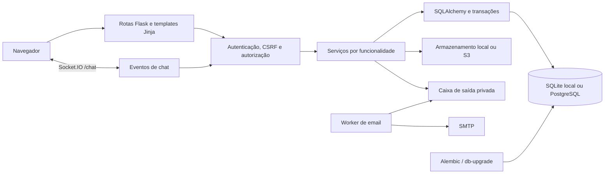

# Arquitetura

O Criti-CARD é uma aplicação Flask organizada por funcionalidades. A renderização inicial ocorre no servidor com Jinja; scripts locais aprimoram busca, formulários, leitura de cards e comunicação em tempo real. O repositório não contém uma SPA ou um serviço de frontend separado.

## Visão geral

O diagrama mostra fronteiras de responsabilidade. Nem toda rota passa por um arquivo chamado `service.py`: algumas funcionalidades mais antigas concentram lógica em seu módulo, enquanto áreas novas usam pacotes explícitos.

## Inicialização

[criticard/__init__.py](../criticard/__init__.py) expõe `create_app(config=None)`. A factory:

1. Carrega defaults e `.env` a partir da raiz, sem depender do diretório corrente.
2. Aplica o dicionário opcional de configuração e valida exigências de produção.
3. Resolve caminhos, prepara pastas e obtém a chave de sessão.
4. Configura engine SQLAlchemy, CLI, imagens, segurança e apresentação.
5. Registra blueprints, recursos de privacidade e Flask-SocketIO.
6. Aplica `ProxyFix` quando há proxies confiáveis configurados.

Em `TESTING=True`, a factory aplica migrações e tenta criar o administrador configurado. Fora desse modo, a atualização do esquema é uma operação explícita. `app.py` instancia a aplicação e oferece o ponto de entrada local e WSGI.

## Mapa dos módulos

| Código | Responsabilidade |
| --- | --- |
| `auth.py`, `security.py`, `navigation.py` | Cadastro, login, identidade da sessão, CSRF e destinos locais |
| `profiles.py`, `community.py`, `cards.py`, `queries.py` | Painel, perfil público, feed de críticas e publicação |
| `catalog.py`, `catalog_images.py`, `card_reviews.py` | Obras disponíveis, ilustrações e crítica única |
| `backlog/` | Coleção individual, estados, progresso e visibilidade |
| `social/` | Curtidas, comentários, follows, amizades, bloqueios, denúncias e notificações |
| `discovery/` | Hub de descoberta e tendências recentes |
| `communities/` | Comunidades temáticas, papéis, entrada e conteúdo |
| `chat/` | Conversas diretas/grupos, histórico, leitura e eventos Socket.IO |
| `accounts/` | Links de conta, transporte de email, worker, exportação e segurança pessoal |
| `settings/` | Schema, defaults, validação e persistência das preferências |
| `privacy/` | Pedidos privados, respostas e limpeza posterior de imagens |
| `progression/` | Política de XP, extrato, concessões, aparência e elegibilidade social |
| `admin.py`, `admin_catalog/` | Administração da comunidade e do catálogo |
| `db.py`, `persistence.py`, `transfer.py` | Engine, migrações, transações, backup e transferência SQLite → PostgreSQL |

## Persistência e transações

Os modelos usam uma `DeclarativeBase` compartilhada. Eles fornecem tabelas e constraints às expressões SQLAlchemy; a aplicação usa principalmente `select`, `insert`, `update` e `delete` do Core. Não há uma sessão ORM global com unidade de trabalho automática.

`get_db()` mantém um wrapper `Database` no contexto Flask (`g`). Seu contexto `with db:` confirma a transação se não houver exceção e faz rollback em caso de erro. O encerramento do contexto da aplicação fecha a conexão.

O wrapper aceita SQL textual para compatibilidade com auxiliares antigos e testes. Parâmetros posicionais `?` são convertidos em binds nomeados, respeitando literais SQL. Isso não substitui a construção segura de consultas: novas regras devem usar expressões SQLAlchemy ou parâmetros explícitos.

`Record` oferece acesso por nome e, por compatibilidade, por posição. A aplicação trabalha com registros e projeções; templates não devem disparar consultas escondidas por propriedades ORM.

No SQLite, conexões habilitam foreign keys e a função `casefold`, com timeout de dez segundos. Arquivos usam `NullPool`; memória usa `StaticPool`. PostgreSQL usa psycopg e validação de conexões por `pool_pre_ping`.

## Famílias de dados

| Família | Entidades e relações principais |
| --- | --- |
| Identidade | `usuarios`, credenciais com hash, estado ativo e versão de sessão |
| Catálogo | `categorias` → `obras`; obra retirada permanece identificável |
| Críticas | `cards` vinculados ao autor e, quando disponível, à obra |
| Coleção | `backlog_items`, único por pessoa/obra, com visibilidade própria |
| Social | Curtidas, comentários, follows de pessoas/obras/categorias, amizade e bloqueio |
| Conversas | Conversa, membros, mensagens, grupo, convites e solicitações |
| Comunidades | Comunidade, membros, posts, comentários, reações, convites e solicitações |
| Conta | Tokens com hash, finalidade, expiração, email e versão de sessão |
| Preferências | Opções da conta com valores e tipos permitidos |
| Progressão | Perfil, eventos de XP, conquistas e recompensas |
| Privacidade | Pedido por titular, histórico de respostas e fila de imagens |

IDs usam `BigInteger` com variante `Integer` em SQLite. Esse detalhe mantém o comportamento de autoincremento local e a capacidade do destino PostgreSQL.

## Migrações

As revisões vivem em [migrations/versions](../migrations/versions). `db-upgrade` envia Alembic até `heads` usando a engine da aplicação. `init-db` é um alias operacional que também migra e preserva os dados.

O histórico inclui ramos iniciais de backlog, social, chat e contas, unidos em `0006_merge`; depois adiciona amizades, preferências, privacidade, administração do catálogo, crítica única, progressão, grupos, comunidades e follows de descoberta.

`0011_unique_cards` arquiva duplicatas históricas para permitir uma crítica publicada por autor/obra; o CLI usa a política padrão de preservar a mais recente. A revisão mantém textos antigos como histórico privado, em vez de apagar duplicatas. As regras para esquemas novos pertencem a novas revisões, nunca à edição de uma revisão já aplicada.

## Identidade e autorização

O cookie Flask transporta uma sessão assinada. `load_user()` busca o usuário e verifica estado ativo, versão e um HMAC associado às credenciais. Senhas e privilégio administrativo não são confiados ao cliente.

Mudanças sensíveis revalidam a identidade depois de bloquear a linha da conta. Isso fecha a janela entre carregar o usuário no início da requisição e efetuar uma escrita após revogação concorrente.

Socket.IO autentica a conexão e cada evento independentemente dos hooks HTTP. O ingresso exige token CSRF da sessão e origem compatível; envio e consulta verificam associação à conversa. A entrega também revalida cada destinatário.

## Interface e assets

Os templates estão em [templates](../templates) e os scripts/estilos em [static](../static). Fontes, cliente Socket.IO e ilustrações do catálogo são locais. [static/catalog/README.md](../static/catalog/README.md) registra a origem das artes.

Formulários tradicionais, links e HTML semântico preservam fluxos úteis sem JavaScript. Aprimoramentos usam os mesmos serviços e permissões dos caminhos HTTP. Contadores, estados de carregamento e mensagens devem manter foco e informação acessível.

## Ciclo de vida e limites

Retirada de obra é uma mudança de `active`, preservando críticas e coleções. Exclusão de conta remove conteúdo autoral e relações pessoais; propriedade de espaços pode ser transferida. Remoção física de imagens ocorre após commit, com fila para repetir falhas.

O registro de conexões Socket.IO é local ao processo. O Dockerfile utiliza um worker Gunicorn com threads, e não existe broker distribuído configurado. Adicionar workers ou réplicas exige redesenhar a distribuição de eventos e validar sessões, entrega e balanceamento.

Detalhes de operação, armazenamento e restauração estão em [Operação](operations.md). As garantias de privacidade e seus limites estão em [Privacidade](privacy-operations.md).
